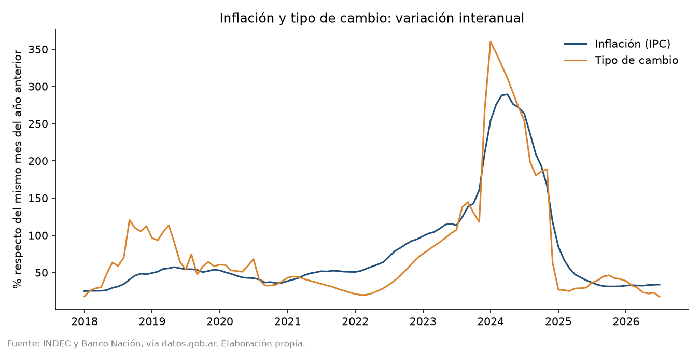
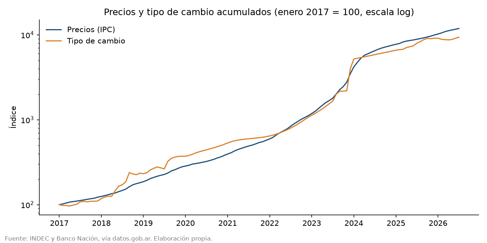
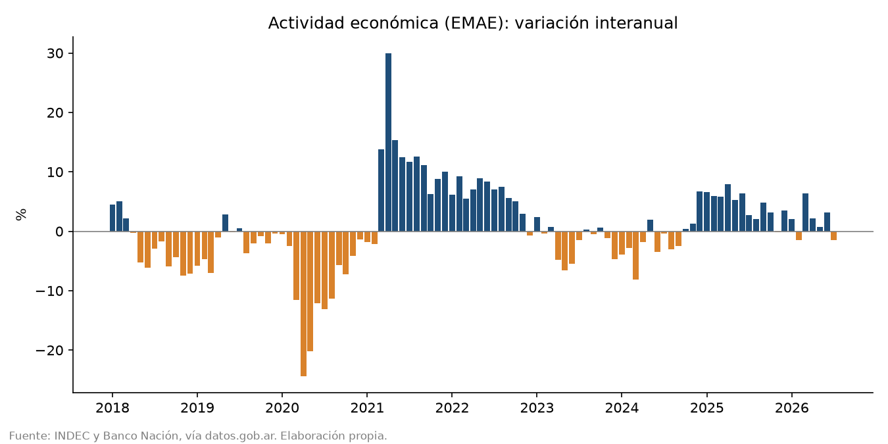
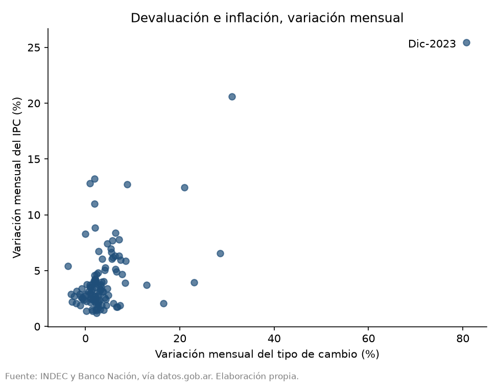

# Tipo de cambio, inflación y actividad en Argentina (2017-2026)

Análisis con Python de la relación entre el tipo de cambio, la inflación y la actividad económica en Argentina, usando datos oficiales mensuales. El foco está en estimar el **traspaso del tipo de cambio a precios** (*pass-through*).

Autor: Lisandro Amarilla, estudiante de Licenciatura en Economía (UNLaM).

## Datos

Tres series mensuales, de enero de 2017 a julio de 2026 (115 meses), descargadas de la API de Series de Tiempo de [datos.gob.ar](https://datos.gob.ar):

| Serie | Fuente |
|---|---|
| IPC nivel general nacional | INDEC |
| Tipo de cambio vendedor (promedio mensual) | Banco de la Nación Argentina |
| EMAE, serie original (actividad económica) | INDEC |

## Metodología

1. **Carga y unión** de las series por mes con `pandas` (`analisis.py`).
2. **Variaciones**: mensuales (contra el mes anterior) e interanuales (contra el mismo mes del año anterior). Para la actividad se usa la variación interanual porque el EMAE original tiene estacionalidad.
3. **Gráficos** con `matplotlib` (`graficos.py`).
4. **Regresión** por mínimos cuadrados con `statsmodels` y errores estándar robustos HC1 (`regresion.py`):

   `inflación(t) = a + b0·devaluación(t) + b1·devaluación(t-1) + b2·devaluación(t-2) + error`

   Se incluyen dos rezagos porque el efecto del dólar sobre los precios no es inmediato. La suma `b0 + b1 + b2` es el traspaso acumulado a tres meses.

## Resultados

| | Todos los meses | Sin dic-2023 |
|---|---|---|
| Observaciones | 112 | 111 |
| Traspaso acumulado (b0+b1+b2) | 0,47 | 0,40 |
| R² | 0,67 | 0,54 |

Interpretación: un punto adicional de devaluación mensual se asocia con entre 0,4 y 0,5 puntos de inflación acumulada en los tres meses siguientes. Todos los coeficientes son significativos al 1%.

La estimación es sensible a **diciembre de 2023**, mes con una devaluación del 80,8% y una inflación del 25,5%: al excluirlo, el efecto contemporáneo baja de 0,25 a 0,15 y el traspaso acumulado de 0,47 a 0,40. Por eso se reportan ambas versiones.

La constante (≈ 2,3 puntos mensuales) indica una inflación de base que no depende del tipo de cambio, coherente con la inercia inflacionaria del período.

## Gráficos






## Limitaciones

- Los coeficientes miden una **asociación estadística**, no una relación causal. En períodos como diciembre de 2023 coincidieron varios cambios a la vez (devaluación, liberación de precios, cambio de gobierno) que el modelo no separa.
- No se controlan otras variables relevantes: expectativas, salarios, precios regulados, política monetaria.
- Se usa el tipo de cambio oficial. Durante los años de restricciones cambiarias (cepo), el dólar oficial no reflejaba el precio marginal de la divisa.
- La variación interanual del EMAE está distorsionada por el efecto base de la pandemia en 2020-2021.
- La actividad económica se describe en los gráficos, pero no entra en la regresión.

## Cómo reproducirlo

```
pip install pandas matplotlib statsmodels
python analisis.py
python graficos.py
python regresion.py
```

Los CSV originales van en la carpeta `datos/` con los nombres `ipc.csv`, `tipo_cambio.csv` y `emae.csv`.

## Estructura

```
├── analisis.py      # carga, unión y variaciones
├── graficos.py      # genera los 4 gráficos
├── regresion.py     # estimación del traspaso
├── datos/           # series descargadas y tabla unida
└── resultados/      # gráficos y salida de la regresión
```
